[Email](mailto:hsyncalti2@gmail.com) · [LinkedIn](https://linkedin.com/in/Huseyin-Can-Calti) · [GitHub Stars](https://github.com/huseyincancalti?tab=stars)

## About

I build useful software for desktop, browser, and media workflows. I deliberately work with AI coding agents, guiding the implementation and reviewing the results.

## Featured work

<table>
  <tr>
    <td width="50%" valign="top">
      <strong><a href="https://github.com/huseyincancalti/Borasuki">Borasuki</a></strong> 
      A Windows app for 2× anime and animation upscaling with Real-CUGAN TensorRT, preview and batch queue workflows, and HEVC Main10 export.
    </td>
    <td width="50%" valign="top">
      <strong><a href="https://github.com/huseyincancalti/Audio-Engine">Audio Engine</a></strong> 
      A Chrome and Firefox extension for per-site volume rules, volume boost, 5-band EQ, and audio compression.
    </td>
  </tr>
  <tr>
    <td width="50%" valign="top">
      <strong><a href="https://github.com/huseyincancalti/EchoPlay">EchoPlay</a></strong> 
      A Windows, macOS, and Linux player that mixes separate game and microphone tracks in NVIDIA ShadowPlay, NVIDIA App, and OBS recordings.
    </td>
    <td width="50%" valign="top">
      <strong><a href="https://github.com/huseyincancalti/XenUpdate">XenUpdate</a></strong> 
      A Windows update manager for Microsoft Store, winget, Windows Update, devices, and GPU or BIOS drivers.
    </td>
  </tr>
  <tr>
    <td colspan="2" valign="top">
      <strong><a href="https://github.com/huseyincancalti/TabGroup-Master">TabGroup Master</a></strong> 
      A local-first browser workspace for nested tab groups, backups, and quick restore.
    </td>
  </tr>
</table>

## GitHub activity

  
  

  <picture>
    <source media="(prefers-color-scheme: dark)" srcset="./profile/contribution-snake-dark.svg" />
    <source media="(prefers-color-scheme: light)" srcset="./profile/contribution-snake.svg" />
    
  </picture>

## Toolkit

**Languages:** C# · C++ · JavaScript · TypeScript · Python  
**Tools:** Unity · Unreal Engine · .NET / WPF · Git · AI coding agents

---

  Building useful things, one focused tool at a time.

